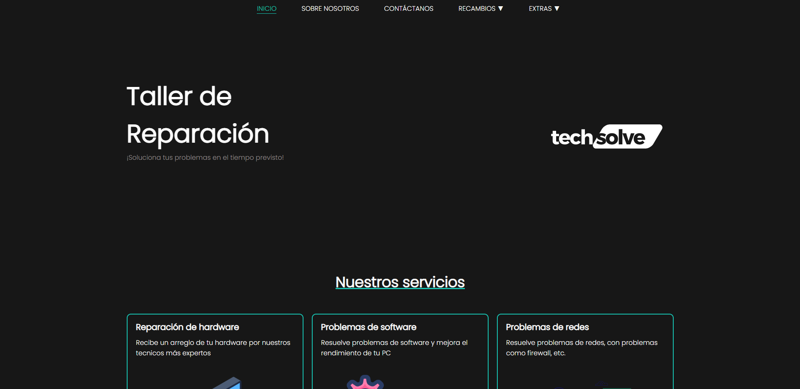
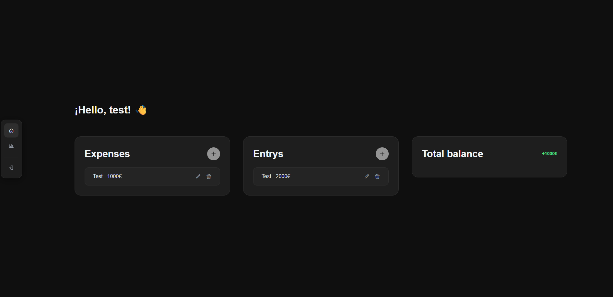
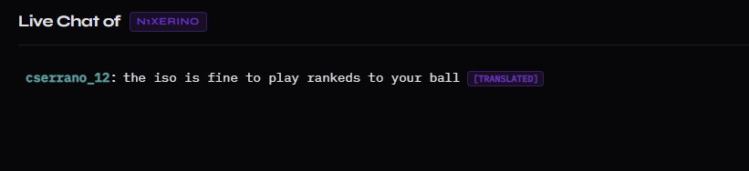
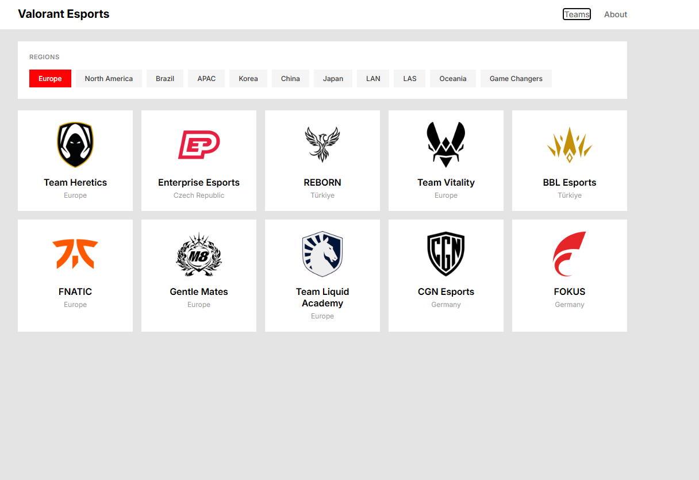
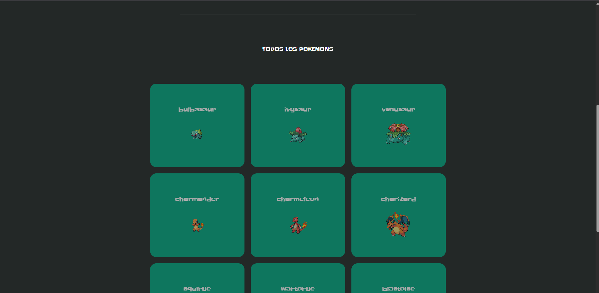

# Juan Manuel Galán Pérez

📄 [Ver mi CV](./cv/CV.pdf)

## Estudios
* **Desarrollo de Aplicaciones Multiplataforma (DAM)** - Actualmente cursando.
* **Sistemas Microinformáticos y Redes (SMIX)** - Titulación completada.

## Tecnologías y Evidencias

### 1. Sistemas e Infraestructura

#### **TechSolve**
* Sitio web simulado de una tienda de reparación de PCs. Permite explorar componentes, periféricos y consultar la guía de resolución de problemas para los dolores de cabeza tecnológicos más comunes.
  * *Tecnologías:* HTML5, CSS, PHP, MySQL, Ubuntu Linux.
* **Evidencia visual:**

* 🔗 [Visitar TechSolve](https://techsolve.vercel.app/)

### 2. Desarrollo Frontend y Consumo de APIs

#### **Expenses control app:** 
* Aplicación web para registrar fácilmente tus gastos diarios, controlar tus ingresos y analizar tus hábitos financieros localmente.
  * *Tecnologías:* React, JavaScript, Node.js, CSS.
* **Evidencia visual:**

* 🔗 [Código de Expenses Control App](https://github.com/juanmagape/expenses-control-app)

#### **Chat Translate:** 
* Aplicación web que se conecta a cualquier canal de Twitch en directo y traduce automáticamente al inglés los mensajes del chat en tiempo real.
  * *Tecnologías:* JavaScript, HTML5, CSS3, WebSockets.
* **Evidencia visual:**

* 🔗 [Probar Chat Translate](https://chat-translate-twitch.vercel.app/)

#### **Valorant Esports:** 
* Aplicación web para realizar un seguimiento de los equipos competitivos de Valorant, sus plantillas, resultados recientes y próximos partidos utilizando datos en tiempo real.
  * *Tecnologías:* React, Node.js, Consumo de APIs asíncrono.
* **Evidencia visual:**

* 🔗 [Ver Valorant Esports](https://valo-esports.vercel.app/)

#### **PokeApi:** 
* Aplicación para explorar estadísticas y habilidades de diferentes Pokémon consumiendo la PokéAPI.
  * *Tecnologías:* JavaScript, Fetch API, HTML/CSS.
* **Evidencia visual:**

* 🔗 [Ver PokeAPI](https://poke-api-juanmagape.vercel.app/)

## Contacto

* **[Mi LinkedIn](https://www.linkedin.com/in/juanma-gape/?locale=en_US)**
* **[Enviar un correo](mailto:juanmagape.trb@gmail.com)**